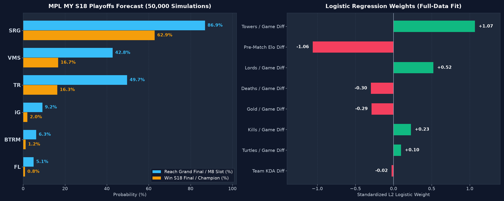

# MPL MY S18 Playoffs Predictor

Who wins MPL Malaysia Season 18 (Mobile Legends: Bang Bang), and who takes the two M8 World Championship slots?

This project turns the 56-match regular season (Aug 14 – Oct 18, 2026) into single-game win probabilities, converts them to Bo5/Bo7 series odds, and runs 50,000 Monte Carlo simulations of the playoff bracket (Oct 28 – Nov 1, 2026). Everything is written from scratch in NumPy/pandas: logistic regression via Newton-Raphson, gradient-boosted stumps, Elo and Bradley-Terry ratings.



## Forecast

| Team | Reach Grand Final (M8 slot) | Champion |
| :--- | ---: | ---: |
| Selangor Red Giants (SRG) | 86.9% | 62.9% |
| Team Rey (TR) | 49.7% | 16.3% |
| Team Vamos (VMS) | 42.8% | 16.7% |
| Invictus Gaming (iG) | 9.2% | 2.0% |
| Bigetron MY by VIT (BTRM) | 6.3% | 1.2% |
| Team Flash (FL) | 5.1% | 0.8% |

Full placement probabilities are in [`data/mpl_my_s18_playoffs_forecast.csv`](data/mpl_my_s18_playoffs_forecast.csv).

## How it works

1. **Data.** 56 regular-season Bo3 results (double round-robin, 8 teams, 136 games) and season totals per team (kills, deaths, assists, gold, damage, lords, turtles, towers). Match results were cross-checked against Liquipedia; all 56 agree, and the standings follow from them.
2. **Ratings.** A chronological Elo (2-0 / 2-1 / 1-2 / 0-2 scored as 1 / 0.75 / 0.25 / 0) and a game-level Bradley-Terry model fitted by MM iterations.
3. **Classifier.** L2 logistic regression and a gradient-boosted stump ensemble predict the Bo3 match winner from Elo and per-game macro differences. Validation is 8-fold leave-one-week-out.
4. **Game probability.** The ML match probability is shrunk to a game probability, then blended: 45% ML, 30% Bradley-Terry, 15% Elo, 10% head-to-head (shrunk toward 50%).
5. **Bracket.** Exact Bo5/Bo7 series probabilities feed a 50,000-run simulation of the hybrid bracket: UB quarterfinals (VMS–FL, iG–BTRM, single elimination), SRG and TR enter at the UB semifinals, Bo7 lower-bracket final and grand final.

## Run it

```bash
pip install -r requirements.txt
python mpl_my_s18_predictor.py
```

Takes a few seconds. It prints the tables and rewrites the CSVs in `data/` and the chart in `assets/`. The simulation is seeded, so results are reproducible.

## Power BI report

`powerbi/MPLS18.pbip` is a Power BI project (PBIP, report in PBIR format) built on the CSVs in `data/`. It has two pages:

- **Playoffs Forecast**: four KPI cards (title favourite, race for the second M8 slot, most likely Grand Final, title chance for seeds 4–6), title and Grand Final odds by team, each team's finishing distribution, key series odds, and the regular-season standings.
- **Model Check**: logistic regression weights, cross-validation scores next to the Elo baseline, and the limitations.

To open it:

1. Run `python mpl_my_s18_predictor.py` once so all CSVs exist.
2. Open `powerbi/MPLS18.pbip` in Power BI Desktop.
3. If the repo is not at `C:\Users\courts\mpl-my-s18-ml-predictor`, go to **Transform data → Edit parameters** and point `DataFolder` at your `data` folder.
4. Click **Refresh**.

## Cross-validation

| Model | Accuracy | ROC-AUC | Brier |
| :--- | ---: | ---: | ---: |
| L2 logistic regression | 0.750 | 0.773 | 0.193 |
| Boosted stumps | 0.696 | 0.678 | 0.213 |
| Blend (65/35) | 0.777 | 0.776 | 0.194 |
| Reference: pre-match Elo only | 0.661 | 0.675 | 0.239 |

The Elo reference uses only matches played before each game, so it has no leakage and needs no training.

## Limitations (read before trusting the numbers)

- **The macro features leak.** Kills, towers, gold etc. are whole-season averages, so every training row already contains the result it is predicting (and later weeks too). The cross-validation scores above are therefore optimistic; the leak-free pre-match Elo reference is the fairer bar.
- **Elo gets a negative weight.** Because the season averages already encode team strength, the logistic model gives pre-match Elo a weight of about −1.06. At prediction time a bigger Elo lead slightly *lowers* the ML probability (SRG vs TR: 74.4% with the real Elo gap, 77.2% with it set to zero). The blend's separate Elo and Bradley-Terry terms soften this.
- **Hand-picked constants.** The match-to-game shrink factor (0.68) and the 45/30/15/10 blend weights are judgement calls, not fitted.
- **Small sample.** 56 matches, 112 directed rows. Treat the forecast as an informed opinion, not a precise estimate.
- **Player stats are not used by the model.** [`data/mpl_my_s18_player_stats.csv`](data/mpl_my_s18_player_stats.csv) lists five main players for each playoff team; substitutes are not included, so totals for TR, VMS, iG and BTRM are below the team totals.

## Ideas for a v2

- Build rolling, pre-match macro features from per-game box scores so nothing from the future enters training.
- Train on game outcomes (136 games) instead of match outcomes, which removes the 0.68 shrink factor.
- Fit the blend weights on out-of-fold predictions and report every model against the Elo baseline.

## Data sources

- Official MPL Malaysia site: <https://my.mpl.mobilelegends.com>
- Liquipedia, MPL Malaysia Season 18: <https://liquipedia.net/mobilelegends/MPL/Malaysia/Season_18>

## License

MIT, see [LICENSE](LICENSE).
